# Nexo Future

[](https://github.com/samuelgomezdev/nexo-future-app/actions/workflows/ci.yml)
[](https://github.com/samuelgomezdev/nexo-future-app/releases/latest)

Aplicativo móvel orientado a testes que conecta jovens adultos a oficinas profissionalizantes e às vagas de empresas que precisam de ofícios manuais e técnicos na região da AMFRI (Itajaí/SC). Cada vaga é ligada aos cursos que preparam para ela, para que o jovem encontre a formação já ligada a uma oportunidade real de emprego.

Projeto do **Hands-On Work VIII** do curso de Análise e Desenvolvimento de Sistemas da Universidade do Vale do Itajaí (Univali), alinhado aos Objetivos de Desenvolvimento Sustentável 4 (educação de qualidade) e 8 (trabalho decente e crescimento econômico).

## Baixar o aplicativo (APK)

A versão atual é a **v0.2.0** (Etapa 2), para Android, com login e dados no Firebase.

- **Download direto:** [app-release.apk](https://github.com/samuelgomezdev/nexo-future-app/releases/download/v0.2.0/app-release.apk) (cerca de 52 MB)
- **Página da versão:** [Releases → v0.2.0](https://github.com/samuelgomezdev/nexo-future-app/releases/tag/v0.2.0)

A **v0.1.0** continua publicada como a versão da Etapa 1 (sem login, com dados fictícios só no aparelho):

- **Download direto:** [app-release.apk](https://github.com/samuelgomezdev/nexo-future-app/releases/download/v0.1.0/app-release.apk) (cerca de 49 MB)
- **Página da versão:** [Releases → v0.1.0](https://github.com/samuelgomezdev/nexo-future-app/releases/tag/v0.1.0)

O APK é gerado automaticamente pelo GitHub Actions a cada nova versão marcada (tag), depois que todos os testes passam.

## Instalar no celular Android

1. Se a v0.1.0 (ou outra versão do Nexo Future) estiver instalada, **desinstale antes**. A assinatura do APK é diferente e o Android não instala uma versão por cima da outra. As duas versões também não ficam juntas no mesmo celular.
2. No celular, abra o link de download da v0.2.0 e baixe o arquivo `app-release.apk`.
3. Abra o arquivo baixado (pela notificação ou pela pasta Downloads).
4. Se o Android pedir, permita a instalação de apps desta fonte ("Instalar apps desconhecidos") para o navegador ou o gerenciador de arquivos.
5. Toque em **Instalar** e depois em **Abrir**.
6. Sem conta, já dá para pesquisar as vagas. Para se candidatar, toque em **Entrar → Cadastre-se**, escolha o perfil, preencha o cadastro e **confirme o e-mail** pelo link que chega na caixa de entrada (confira também o spam). Depois, entre com o e-mail e a senha.

Como o app ainda não está na Google Play, o Android pode mostrar um aviso de segurança. Basta confirmar a instalação.

Na v0.2.0, as vagas da pesquisa são publicadas por contas de empresa no Cloud Firestore, com cursos enviados por oficinas e aprovados pelas empresas. As empresas e oficinas são fictícias, criadas para os testes com usuários. O roteiro desses testes está em [`docs/ROTEIRO_TESTES_V0.2.0.md`](docs/ROTEIRO_TESTES_V0.2.0.md).

## Funcionalidades da v0.1.0 (Etapa 1)

| | Funcionalidade | O que dá para fazer |
|---|---|---|
| F1 | Pesquisar vagas | Lista de vagas em páginas de 15, com busca por texto e filtro por área. |
| F2 | Ver o detalhe da vaga | Empresa, cidade, área, qualificação exigida e os cursos vinculados à vaga. |
| F3 | Candidatar-se | Candidatura em 2 toques. Só vagas com a situação "Aceitando candidaturas" aceitam candidatura, e cada jovem pode ter no máximo 5 candidaturas ativas. |
| F4 | Minhas candidaturas | Acompanhar as candidaturas ativas e desistir de uma delas. |

Ao tentar a 6ª candidatura, o app mostra um aviso com atalho para "Minhas candidaturas", onde o jovem pode desistir de uma vaga e liberar espaço.

| Lista de vagas | Detalhe da vaga | Aviso de limite | Minhas candidaturas |
|---|---|---|---|
| 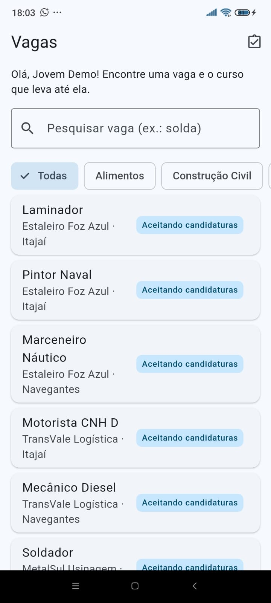 | 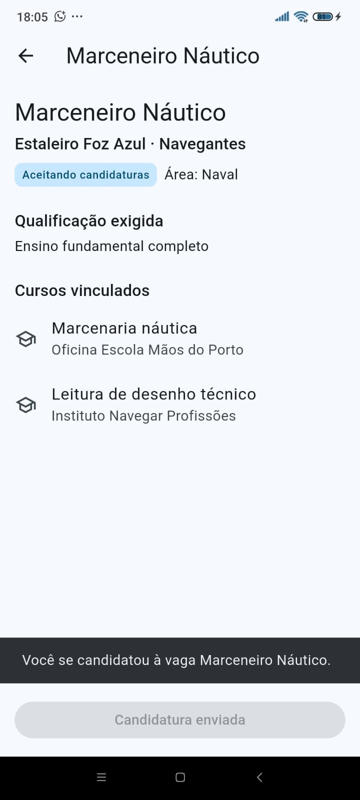 | 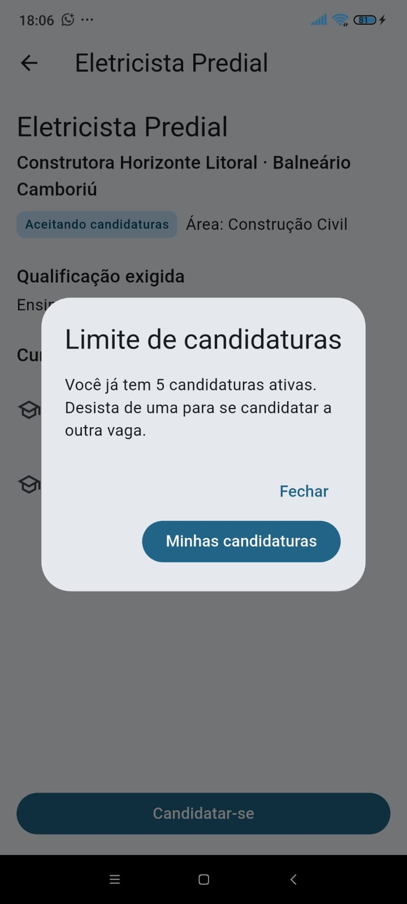 | 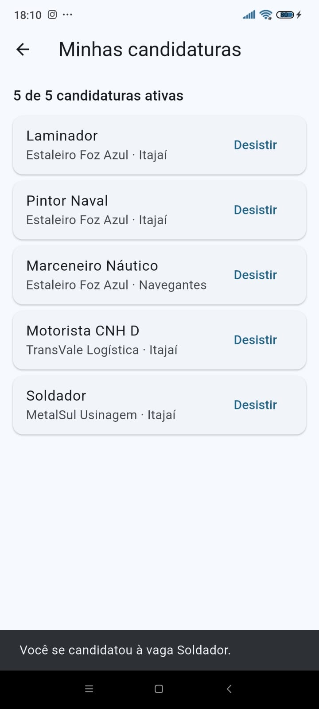 |

## Novidades da v0.2.0 (Etapa 2)

Com o Firebase (Authentication e Cloud Firestore), testado no celular:

| | Funcionalidade | O que dá para fazer |
|---|---|---|
| F5 | Entrar | Login com e-mail e senha (Firebase Authentication), com os erros apontados no próprio campo. |
| F6 | Bloqueio por senha errada | Depois de 5 senhas erradas, o login fica bloqueado por 15 minutos, com contagem regressiva. |
| F7 | Cadastro do jovem | Nome, e-mail, senha, cidade da AMFRI e data de nascimento; envio do e-mail de confirmação e perfil salvo no Cloud Firestore. |
| F8 | Política de Privacidade | Texto em linguagem simples e aceite obrigatório no cadastro, com a data do aceite registrada. |
| F9 | Escolha do perfil | No "Cadastre-se", a pessoa escolhe entre jovem, empresa e oficina; cada perfil tem o seu cadastro. |
| F10 | Cadastro da empresa | Em 2 etapas: razão social, CNPJ (com máscara e conferência dos dígitos), setor e e-mail do recrutador; depois nome do recrutador, cidade, senha e Política de Privacidade. |
| F11 | Cadastro da oficina | Em 2 etapas: dados da oficina e, na segunda, o alvará de ensino (número e validade). Dá para enviar o alvará depois, mas sem ele a oficina não publica cursos (RN0003). |
| F12 | Visitante e login por perfil | Sem conta, dá para pesquisar vagas e ver o detalhe com os cursos vinculados. Candidatar-se pede login e, depois de entrar, o app volta para a mesma vaga. Ao entrar, a empresa vai para o painel do recrutador e a oficina vê se já pode publicar cursos (RN0003). |
| F13 | Cadastro de vaga | No painel, a empresa publica a vaga com cargo, área, posições, cidade da AMFRI e qualificação exigida, com os campos obrigatórios apontados. Pode escolher até 5 cursos preferenciais entre os já aprovados da mesma área; sem curso, a vaga nasce "Aguardando cursos". Ela já aparece na pesquisa, também para o visitante. |
| F14 | Cadastro de curso | A oficina monta o curso para uma vaga (nome, carga horária, vagas na turma e descrição); a área vem da vaga. Sem o alvará em dia, o curso só fica salvo como rascunho (RN0003) e pode ser publicado depois. |
| F15 | Aprovação do curso | A empresa vê os cursos propostos para cada vaga e aprova ou recusa. Ao aprovar, o curso é vinculado à vaga (no máximo 5, RN0006) e a vaga passa a aceitar candidaturas (RF0007). |
| F16 | Vagas e cursos no Firestore | Vagas e cursos ficam no Cloud Firestore; a pesquisa mostra as vagas publicadas pelas empresas em páginas de 15, das mais novas para as mais antigas, e a lista atualiza ao puxar para baixo. |
| F17 | Candidaturas na conta e vaga lotada | As candidaturas do jovem ficam salvas no Cloud Firestore, na conta dele, e cada vaga conta as que recebeu. Quando as candidaturas preenchem as posições, a vaga fica "Lotada" e para de aceitar candidaturas. O painel da empresa mostra as vagas abertas, as candidaturas recebidas e as posições preenchidas. |

O visual segue o protótipo de alta fidelidade feito no Figma, com a identidade do projeto (azul `#004089` e fonte Inter).

### Proteção de dados (LGPD)

- **Só o necessário:** o cadastro não pede CPF, RG, endereço nem foto.
- **Menores de idade:** de 12 a 17 anos, o cadastro exige a confirmação de que um responsável autorizou; menores de 12 anos não se cadastram.
- **Consentimento:** o aceite da Política de Privacidade é obrigatório e fica registrado com data e hora.
- **Senha:** fica só no Firebase Authentication; o perfil salvo no Firestore não guarda a senha.
- **Regras do Cloud Firestore:** cada pessoa lê e grava só o próprio perfil (de jovem, empresa ou oficina), o perfil não aceita campos fora do cadastro (como CPF ou senha) e as demais coleções ficam fechadas. Vagas e cursos não guardam dados pessoais e podem ser lidos sem conta; só a empresa dona grava a vaga, só a oficina dona grava o curso (publicado só com alvará em dia), só a empresa dona da vaga aprova o curso e ninguém publica antes de confirmar o e-mail (RN0001). As candidaturas ficam na conta de cada jovem, que só lê e grava as próprias, no máximo 5, com a contagem da vaga ajustada junto. As regras têm 75 testes automáticos que rodam no emulador do Firebase, também no GitHub Actions ([`testes_regras`](testes_regras)).
- **Dados no Brasil:** o banco fica em São Paulo (`southamerica-east1`).
- **Testes e evidências:** usam apenas contas e dados fictícios.

| Bloqueio após 5 senhas erradas (celular) | Login no celular (vídeo) |
|---|---|
| 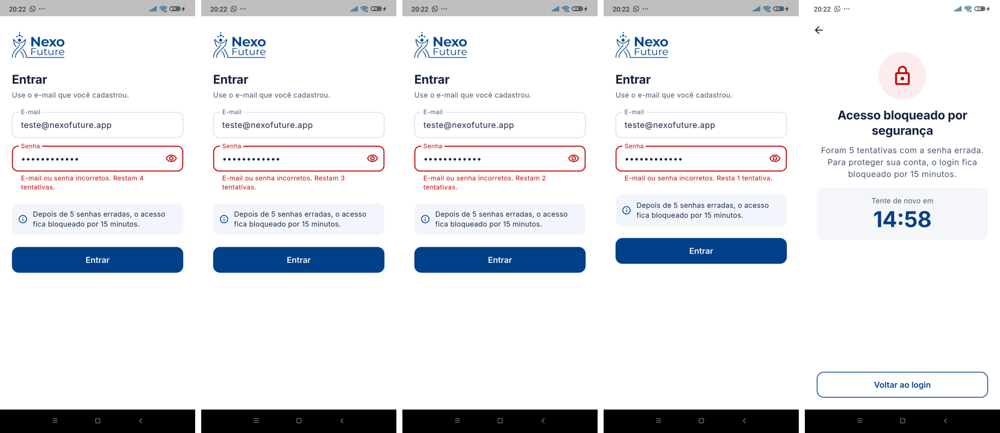 | [sprint2-login-celular.mp4](docs/evidencias/sprint2-login-celular.mp4) |

Cadastros de empresa e oficina testados no celular com o Firebase, usando contas de teste do projeto:

| Escolha do perfil | Empresa: campos obrigatórios | Oficina: alvará de ensino |
|---|---|---|
| 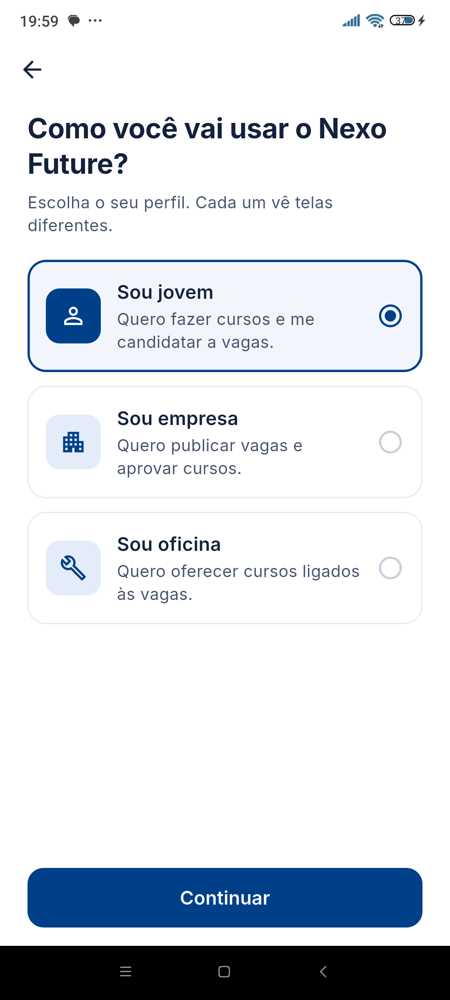 | 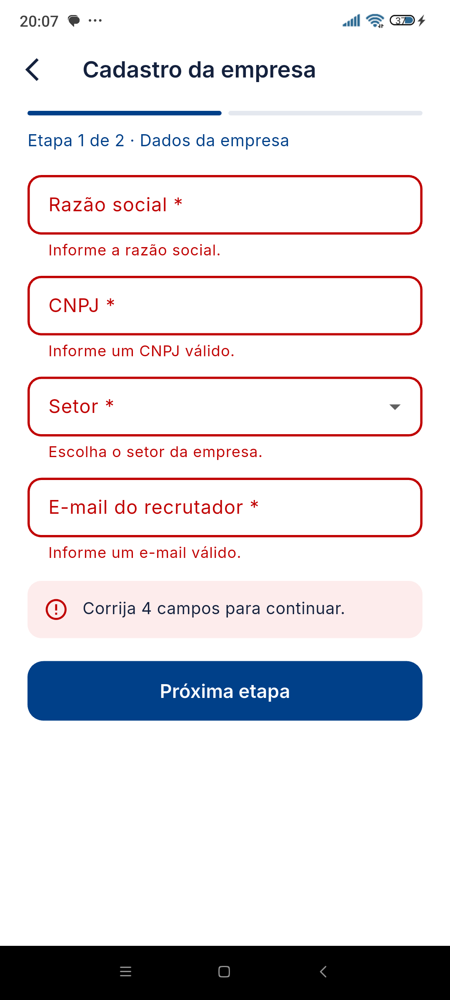 | 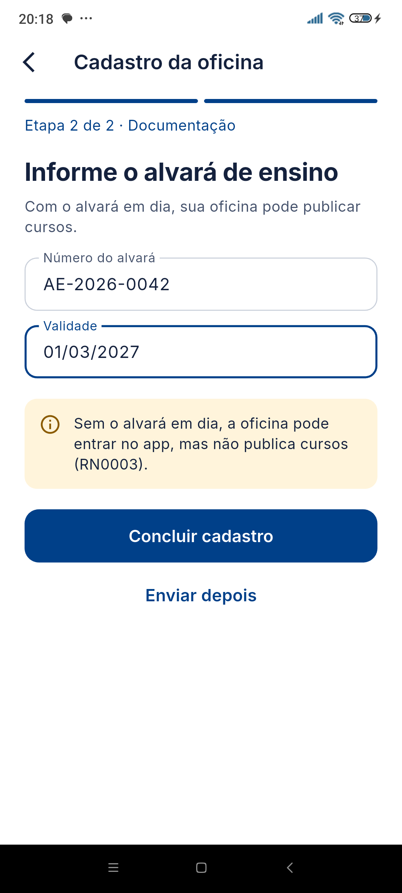 |

Vídeos: [cadastro da empresa](docs/evidencias/sprint2-cadastro-empresa.mp4) · [oficina com alvará](docs/evidencias/sprint2-cadastro-oficina-com-alvara.mp4) · [oficina sem alvará ("Enviar depois")](docs/evidencias/sprint2-cadastro-oficina-enviar-depois.mp4)

Acesso de visitante (RN0007) e login por perfil (RF0019), no celular com o Firebase:

| Visitante vê as vagas | Candidatar-se pede conta | Painel da empresa | Oficina com alvará | Oficina sem alvará |
|---|---|---|---|---|
| 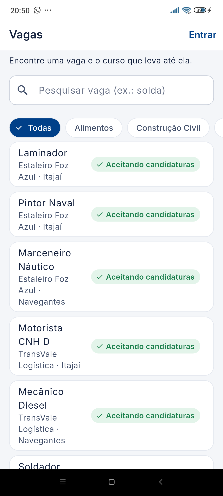 | 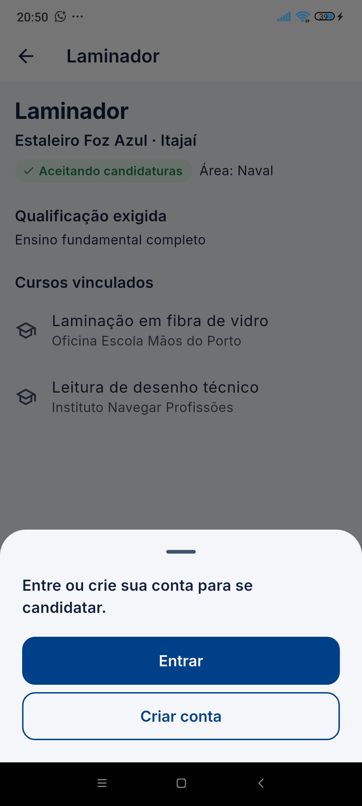 | 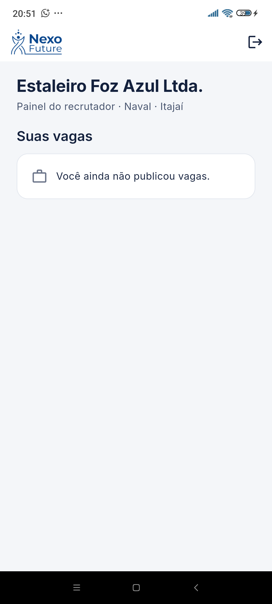 | 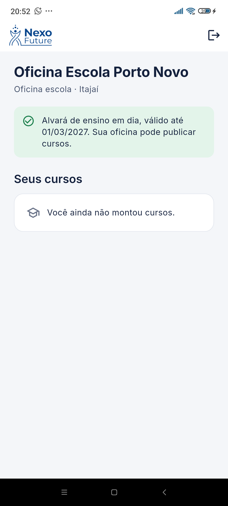 | 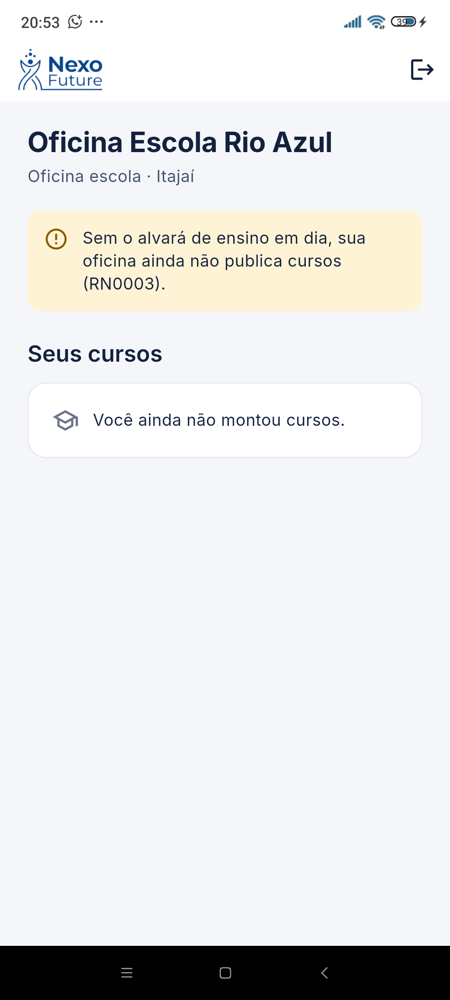 |

Vídeos: [visitante e login da empresa](docs/evidencias/sprint2-visitante-e-login-empresa.mp4) · [login da oficina com alvará](docs/evidencias/sprint2-login-oficina-com-alvara.mp4) · [login da oficina sem alvará](docs/evidencias/sprint2-login-oficina-sem-alvara.mp4)

Cadastro de vagas e cursos, aprovação do recrutador e candidaturas (Sprint 3), no celular com o Firebase e contas de teste do projeto:

| Painel da empresa (E1) | Nova vaga: campos obrigatórios (E2) | Vaga publicada | Curso sem alvará: rascunho (O2) | Curso com alvará (O2) |
|---|---|---|---|---|
| 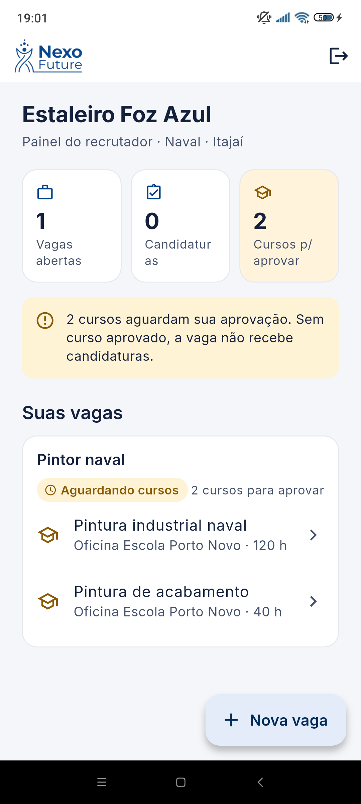 | 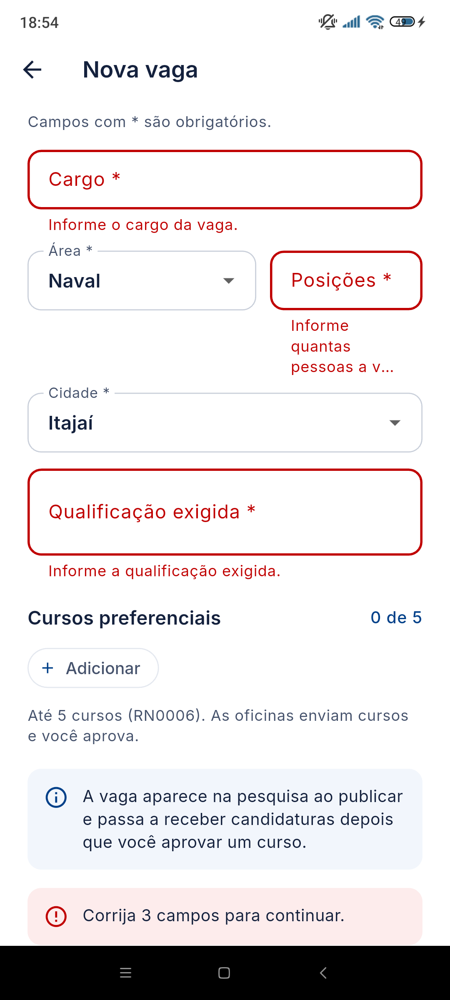 | 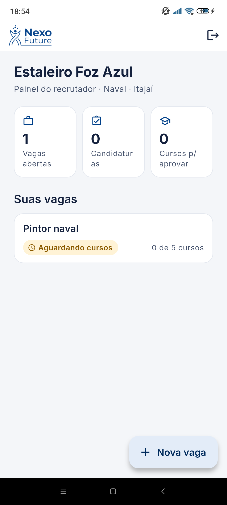 | 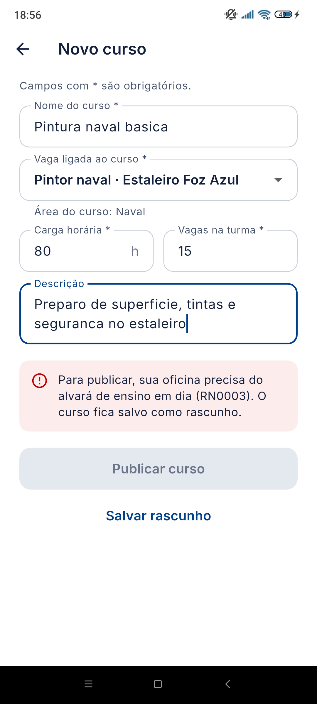 | 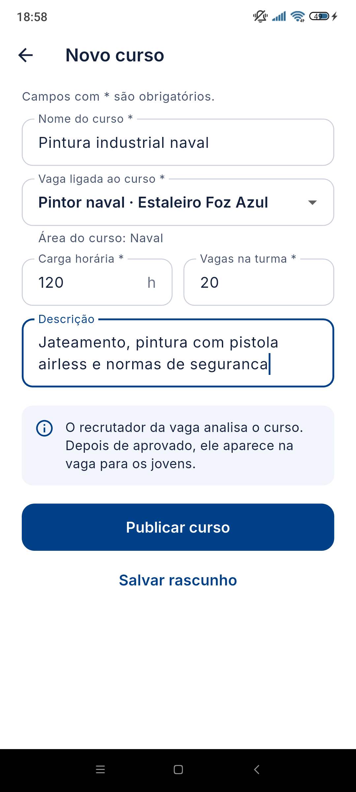 |

| Aprovar curso (E3) | Cursos da oficina (O1) | Vaga com o curso aprovado |
|---|---|---|
| 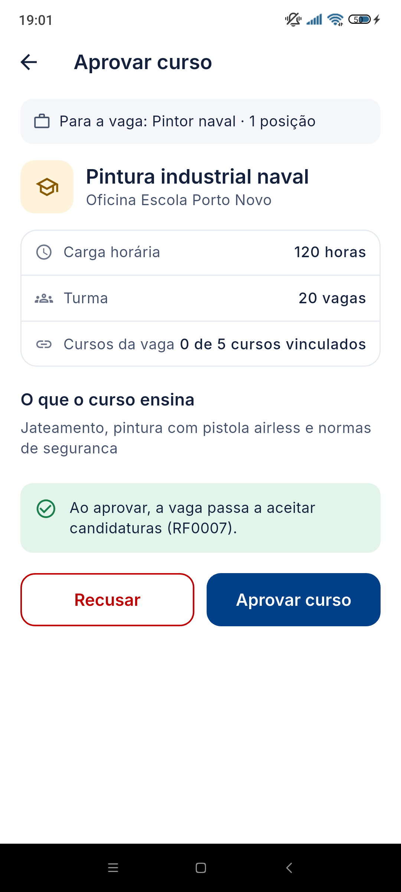 | 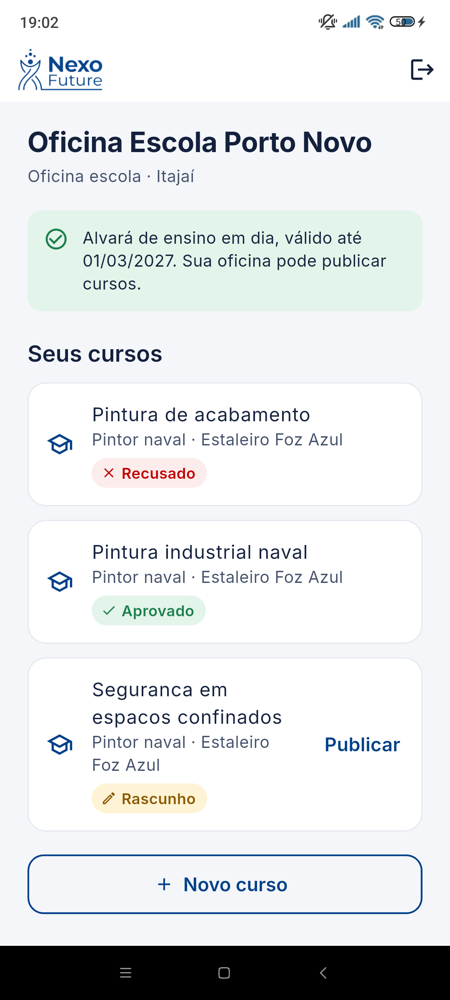 | 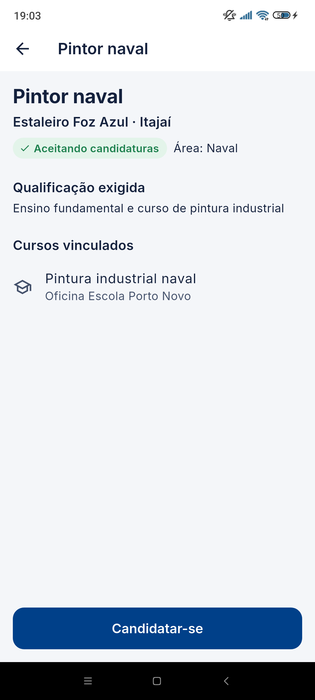 |

Vídeos: [fluxo completo: empresa publica a vaga, oficina propõe o curso, recrutador aprova e jovem entra como visitante e se candidata](docs/evidencias/sprint3-fluxo-real-firebase.mp4) · [oficina sem alvará salva o curso como rascunho](docs/evidencias/sprint3-oficina-rascunho.mp4) · [visitante tenta se candidatar, entra como jovem e a vaga lota](docs/evidencias/sprint3-visitante-e-login-jovem.mp4)

Os mesmos fluxos nos testes de integração rodando no celular, com contas e dados fictícios: [empresa publica a vaga, oficina propõe o curso, recrutador aprova e jovem se candidata](docs/evidencias/sprint3-integracao-vaga-curso-candidatura.mp4) · [cadastro da empresa, confirmação do e-mail e login](docs/evidencias/sprint3-integracao-login-cadastro.mp4)

## Desenvolvimento orientado a testes (TDD)

Cada regra foi desenvolvida no ciclo do TDD: primeiro o teste é escrito e falha (vermelho), depois vem o código mínimo que o faz passar (verde). No histórico de commits, cada regra aparece em dois registros seguidos: `test: ... (vermelho)` e `feat: ... (verde)`.

| Regra / requisito | O que o teste garante |
|---|---|
| RN0005 | Cada jovem tem no máximo 5 candidaturas ativas; ao desistir de uma, volta a poder se candidatar. |
| RF0007 | Só vaga com a situação "Aceitando candidaturas" aceita candidatura. |
| RN0006 | Cada vaga aceita no máximo 5 cursos preferenciais. |
| RNF0002 | A pesquisa devolve as vagas em páginas de 15, com filtro por texto e por área. |
| UC0007 (E1) | Na 6ª candidatura, a tela mostra o aviso de limite com atalho para "Minhas candidaturas". |
| RNF0009 | A candidatura é concluída em até 3 toques (teste de integração executado no celular). |
| RNF0007 | Depois de 5 senhas erradas, o login fica bloqueado por 15 minutos; a contagem é separada por e-mail. |
| RF0003 | O cadastro do jovem valida os campos, a cidade da AMFRI, a idade (responsável de 12 a 17 anos) e o aceite da Política de Privacidade. |
| RF0016 | Ao criar a conta, o app envia o e-mail de confirmação e só deixa entrar depois que o e-mail é confirmado. |
| RF0001 | O cadastro da empresa valida o nome, o CNPJ (dígitos verificadores), o recrutador, o e-mail, a senha, a cidade da AMFRI e o aceite da Política de Privacidade. |
| RF0002 | O cadastro da oficina valida os mesmos campos da empresa e o alvará de ensino: opcional no cadastro, mas, se informado, com número e validade em dia. |
| RN0003 | A oficina só publica curso com o alvará de ensino apresentado e dentro da validade. |
| RN0007 | O visitante vê vagas e cursos sem conta; candidatar-se e os painéis de empresa e oficina pedem login. |
| RF0019 | O login abre as telas do perfil de quem entrou: jovem, empresa ou oficina. |
| RF0004 e RN0001 | Só a empresa com o e-mail confirmado publica vaga; a vaga nasce aberta, sem cursos, e os campos obrigatórios vazios ficam apontados (tela E2). |
| RF0005 e RN0003 | A oficina publica curso ligado a uma vaga só com o alvará em dia; sem ele, salva o rascunho (tela O2). |
| RF0007, RF0015 e RN0006 | Só a empresa dona da vaga aprova o curso; ao aprovar, o curso é vinculado (no máximo 5) e a vaga passa a aceitar candidaturas (tela E3). |
| RNF0002 | As vagas publicadas no Firestore entram na pesquisa paginada de 15, também para o visitante. |
| RF0008 e RF0017 | A vaga fica "Lotada" quando as candidaturas preenchem as posições; as candidaturas ficam salvas na conta do jovem e, ao desistir, a vaga volta a aceitar. |
| RF0015 | Ao publicar a vaga, a empresa escolhe até 5 cursos preferenciais entre os aprovados da mesma área. |
| E1 | O painel da empresa mostra as candidaturas recebidas e as posições preenchidas de cada vaga. |
| Regras do Firestore | Vagas e cursos com campos fechados, escrita só pela dona e aprovação só pela empresa da vaga; candidaturas só do próprio jovem, no máximo 5, com a contagem da vaga ajustada junto. |
| Celular | Na largura de um celular, os campos de escolha cabem na tela (achado no teste em aparelho real). |
| RF0008 | O detalhe da vaga mostra "Lotada" logo depois da candidatura que completa as posições (achado no teste em aparelho real). |
| RF0004 | A mensagem de erro do campo Posições aparece inteira, também com a fonte grande do celular (achado no teste em aparelho real). |
| RNF0002 | Com o Firestore, a pesquisa mostra só as vagas publicadas; as fictícias do seed ficam só no modo sem Firebase dos testes. |

As evidências de cada ciclo (prints dos testes vermelhos e verdes, do Actions e da cobertura) estão em [`docs/evidencias`](docs/evidencias).

### Testes e cobertura

São **354 testes automatizados**, todos passando, além dos 75 testes das regras do Firestore:

| Tipo | Arquivos | Testes |
|---|---|---|
| Unitários de regras de negócio | `test/domain` | 129 |
| Unitários da camada de dados | `test/data` | 44 |
| ViewModels | `test/ui/viewmodels` | 79 |
| Widgets (telas e máscaras de data e CNPJ) | `test/ui` | 99 |
| Integração no dispositivo | `integration_test` | 3 |

Nos testes, o Firebase é substituído por versões falsas em memória (`test/apoio`), para que rodem rápido e sem internet.

Cobertura medida com `flutter test --coverage`: **96,9%** do código, com 96,1% nas regras de negócio (`lib/domain`), 100% na camada de dados e 96,8% nas telas. A meta do projeto é pelo menos 80% nas regras de negócio.

A integração contínua (GitHub Actions) roda `flutter analyze` e todos os testes a cada envio para o repositório.

## Rodar o projeto e os testes

Pré-requisitos: [Flutter](https://docs.flutter.dev/get-started/install) (canal stable, Dart 3.13 ou superior) e Android Studio com um emulador ou um celular Android com a depuração USB ativada.

```bash
git clone https://github.com/samuelgomezdev/nexo-future-app.git
cd nexo-future-app
flutter pub get

# rodar o app no emulador ou no celular conectado
flutter run

# testes unitários e de widgets, com cobertura
flutter test --coverage
dart run tool/cobertura.dart   # resumo da cobertura por arquivo e por camada

# regras de segurança do Firestore, no emulador do Firebase (precisa do Node.js;
# usa o Java 21+ do computador ou, se não houver, o JDK do Android Studio)
powershell -ExecutionPolicy Bypass -File tool/testar_regras.ps1

# testes de integração (precisam de um emulador ou celular conectado)
flutter test integration_test/fluxo_candidatura_test.dart
flutter test integration_test/login_cadastro_test.dart
flutter test integration_test/fluxo_vaga_curso_candidatura_test.dart

# gerar o APK
flutter build apk --release
```

## Estrutura do código

O app segue uma arquitetura em camadas, no estilo MVVM, com `provider` e `ChangeNotifier`:

```
lib/
  domain/   modelos (vaga, candidatura, jovem), regras de negócio e login
  data/     repositórios, dados fictícios das vagas e adaptadores do Firebase
  ui/       telas (screens), viewmodels e tema visual
test/       testes unitários, de viewmodels e de widgets (apoio/: Firebase falso)
integration_test/   teste de integração no dispositivo
```

## Tecnologias

- Flutter e Dart
- `flutter_test` e `integration_test` para os testes
- `provider` para o gerenciamento de estado
- Firebase Authentication (login e confirmação de e-mail) e Cloud Firestore (perfis, vagas, cursos e candidaturas)
- Figma para o protótipo de alta fidelidade
- Git, GitHub e GitHub Actions para versionamento, integração contínua e geração do APK
- Trello para o Scrum: [quadro do projeto](https://trello.com/b/442R72Le/how-viii)

## Próximos passos (Etapa 2)

- Nova versão do APK (v0.2.0) com login e cadastros.
- Validação em dispositivos reais e com usuários da comunidade.

Na Etapa 1, o app foi gerado e testado apenas no Android; a versão iOS depende de um computador com macOS.

## Equipe

- Enzo Mendes Miranda da Silva – Product Owner
- Rafael de Jesus da Silva Nunes – Time de Desenvolvimento
- Samuel Gomez da Silva – Scrum Master

Análise e Desenvolvimento de Sistemas – Universidade do Vale do Itajaí (Univali), 2026.
