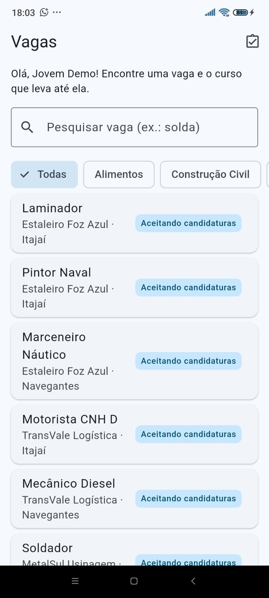
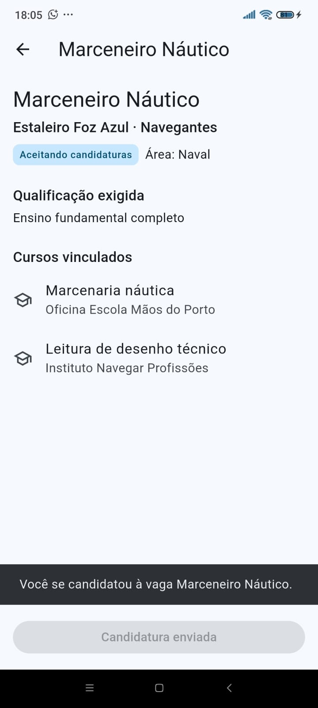
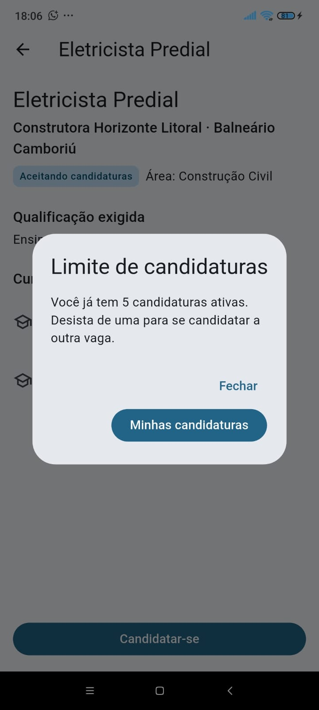
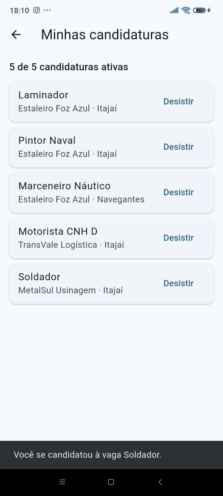

# Nexo Future

[](https://github.com/samuelgomezdev/nexo-future-app/actions/workflows/ci.yml)
[](https://github.com/samuelgomezdev/nexo-future-app/releases/latest)

Aplicativo móvel orientado a testes que conecta jovens adultos a oficinas profissionalizantes e às vagas de empresas que precisam de ofícios manuais e técnicos na região da AMFRI (Itajaí/SC). Cada vaga é ligada aos cursos que preparam para ela, para que o jovem encontre a formação já ligada a uma oportunidade real de emprego.

Projeto do **Hands-On Work VIII** do curso de Análise e Desenvolvimento de Sistemas da Universidade do Vale do Itajaí (Univali), alinhado aos Objetivos de Desenvolvimento Sustentável 4 (educação de qualidade) e 8 (trabalho decente e crescimento econômico).

## Baixar o aplicativo (APK)

A versão atual é a **v0.1.0** (Etapa 1), para Android.

- **Download direto:** [app-release.apk](https://github.com/samuelgomezdev/nexo-future-app/releases/download/v0.1.0/app-release.apk) (cerca de 49 MB)
- **Página da versão:** [Releases → v0.1.0](https://github.com/samuelgomezdev/nexo-future-app/releases/tag/v0.1.0)

O APK é gerado automaticamente pelo GitHub Actions a cada nova versão marcada (tag), depois que todos os testes passam.

## Instalar no celular Android

1. No celular, abra o link de download acima e baixe o arquivo `app-release.apk`.
2. Abra o arquivo baixado (pela notificação ou pela pasta Downloads).
3. Se o Android pedir, permita a instalação de apps desta fonte ("Instalar apps desconhecidos") para o navegador ou o gerenciador de arquivos.
4. Toque em **Instalar** e depois em **Abrir**.

Como o app ainda não está na Google Play, o Android pode mostrar um aviso de segurança. Basta confirmar a instalação.

Nesta versão não há login: o app abre direto com um perfil de jovem de demonstração e usa vagas e cursos fictícios de empresas e oficinas da região. O login e os cadastros, com o Firebase, estão previstos para a Etapa 2.

## Funcionalidades da versão v0.1.0

| | Funcionalidade | O que dá para fazer |
|---|---|---|
| F1 | Pesquisar vagas | Lista de vagas em páginas de 15, com busca por texto e filtro por área. |
| F2 | Ver o detalhe da vaga | Empresa, cidade, área, qualificação exigida e os cursos vinculados à vaga. |
| F3 | Candidatar-se | Candidatura em 2 toques. Só vagas com a situação "Aceitando candidaturas" aceitam candidatura, e cada jovem pode ter no máximo 5 candidaturas ativas. |
| F4 | Minhas candidaturas | Acompanhar as candidaturas ativas e desistir de uma delas. |

Ao tentar a 6ª candidatura, o app mostra um aviso com atalho para "Minhas candidaturas", onde o jovem pode desistir de uma vaga e liberar espaço.

| Lista de vagas | Detalhe da vaga | Aviso de limite | Minhas candidaturas |
|---|---|---|---|
|  |  |  |  |

## Desenvolvimento orientado a testes (TDD)

Cada regra foi desenvolvida no ciclo do TDD: primeiro o teste é escrito e falha (vermelho), depois vem o código mínimo que o faz passar (verde). No histórico de commits, cada regra aparece em dois registros seguidos: `test: ... (vermelho)` e `feat: ... (verde)`.

| Regra / requisito | O que o teste garante |
|---|---|
| RN0005 | Cada jovem tem no máximo 5 candidaturas ativas; ao desistir de uma, volta a poder se candidatar. |
| RF0007 | Só vaga com a situação "Aceitando candidaturas" aceita candidatura. |
| RN0006 | Cada vaga aceita no máximo 5 cursos preferenciais. |
| RNF0002 | A pesquisa devolve as vagas em páginas de 15, com filtro por texto e por área. |
| UC0007 (E1) | Na 6ª candidatura, a tela mostra o aviso de limite com atalho para "Minhas candidaturas". |
| RNF0009 | A candidatura é concluída em até 3 toques (teste de integração executado no celular). |

As evidências de cada ciclo (prints dos testes vermelhos e verdes, do Actions e da cobertura) estão em [`docs/evidencias`](docs/evidencias).

### Testes e cobertura

São **58 testes automatizados**, todos passando:

| Tipo | Arquivos | Testes |
|---|---|---|
| Unitários de regras de negócio | `test/domain` | 13 |
| Unitários da camada de dados | `test/data` | 24 |
| ViewModels | `test/ui/viewmodels` | 13 |
| Widgets (telas) | `test/ui/screens` | 7 |
| Integração no dispositivo | `integration_test` | 1 |

Cobertura medida com `flutter test --coverage`: **94,8%** do código, com 81,5% nas regras de negócio (`lib/domain`), 100% na camada de dados e 94,1% nas telas. A meta do projeto é pelo menos 80% nas regras de negócio.

A integração contínua (GitHub Actions) roda `flutter analyze` e todos os testes a cada envio para o repositório.

## Rodar o projeto e os testes

Pré-requisitos: [Flutter](https://docs.flutter.dev/get-started/install) (canal stable, Dart 3.13 ou superior) e Android Studio com um emulador ou um celular Android com a depuração USB ativada.

```bash
git clone https://github.com/samuelgomezdev/nexo-future-app.git
cd nexo-future-app
flutter pub get

# rodar o app no emulador ou no celular conectado
flutter run

# testes unitários e de widgets, com cobertura
flutter test --coverage
dart run tool/cobertura.dart   # resumo da cobertura por arquivo e por camada

# teste de integração (precisa de um emulador ou celular conectado)
flutter test integration_test/fluxo_candidatura_test.dart

# gerar o APK
flutter build apk --release
```

## Estrutura do código

O app segue uma arquitetura em camadas, no estilo MVVM, com `provider` e `ChangeNotifier`:

```
lib/
  domain/   modelos (vaga, candidatura) e regras de negócio
  data/     repositórios e dados fictícios das vagas
  ui/       telas (screens) e viewmodels
test/       testes unitários, de viewmodels e de widgets
integration_test/   teste de integração no dispositivo
```

## Tecnologias

- Flutter e Dart
- `flutter_test` e `integration_test` para os testes
- `provider` para o gerenciamento de estado
- Git, GitHub e GitHub Actions para versionamento, integração contínua e geração do APK
- Trello para o Scrum: [quadro do projeto](https://trello.com/b/442R72Le/how-viii)

## Próximos passos (Etapa 2)

- Login e cadastros de empresas, oficinas e alunos com Firebase Authentication e Cloud Firestore.
- Cadastro de vagas e de cursos e vínculo curso–vaga com aprovação do recrutador.
- Validação em dispositivos reais e com usuários da comunidade.

Na Etapa 1, o app foi gerado e testado apenas no Android; a versão iOS depende de um computador com macOS.

## Equipe

- Enzo Mendes Miranda da Silva – Product Owner
- Rafael de Jesus da Silva Nunes – Time de Desenvolvimento
- Samuel Gomez da Silva – Scrum Master

Análise e Desenvolvimento de Sistemas – Universidade do Vale do Itajaí (Univali), 2026.
