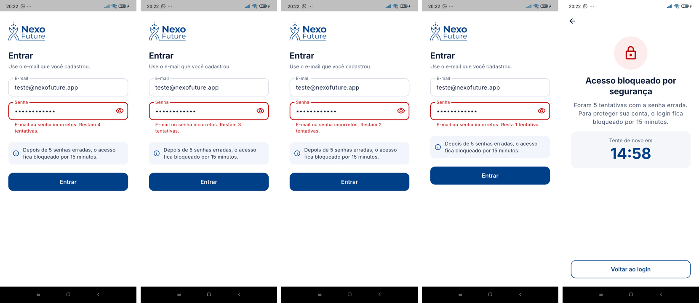
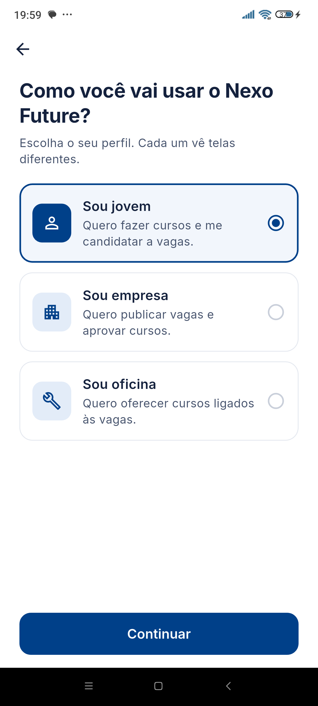
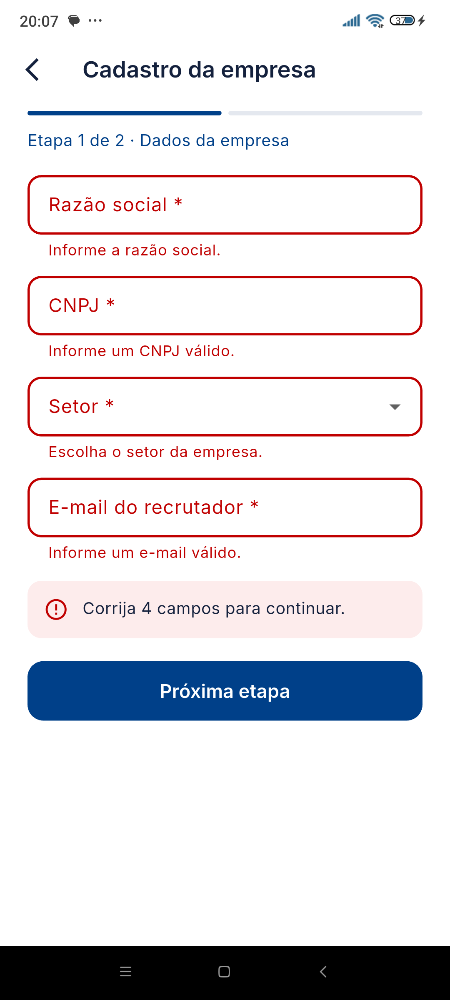
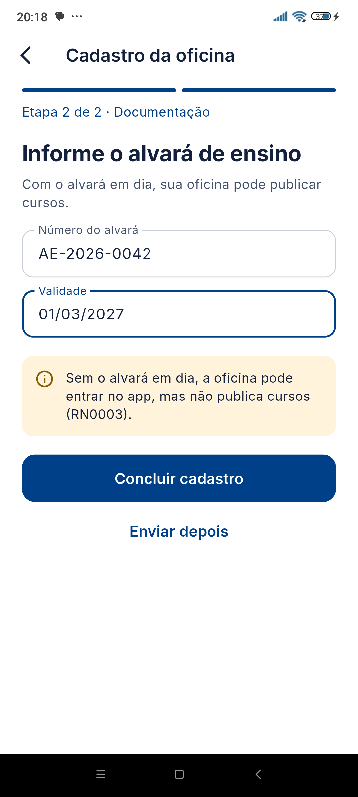
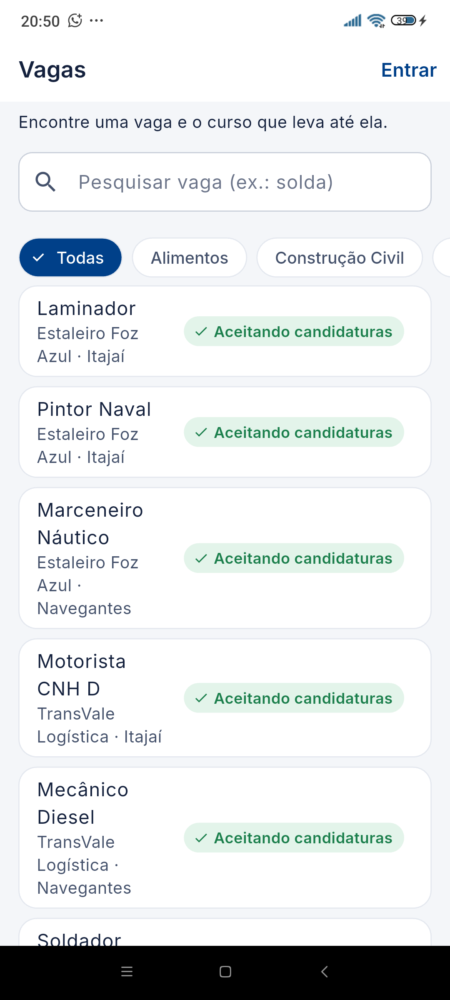
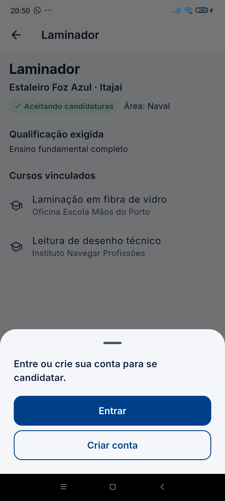
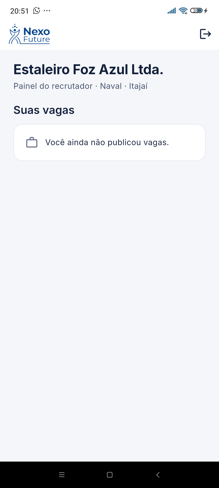
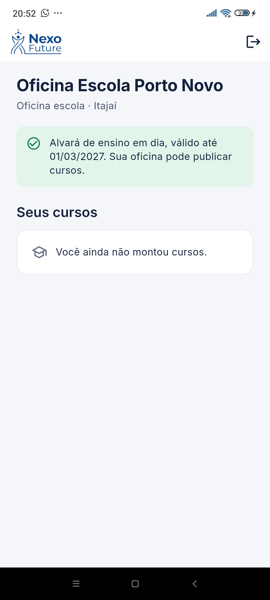
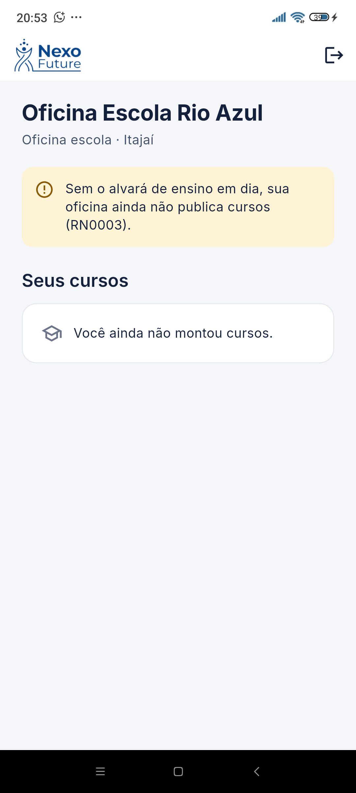

# Nexo Future

[](https://github.com/samuelgomezdev/nexo-future-app/actions/workflows/ci.yml)
[](https://github.com/samuelgomezdev/nexo-future-app/releases/latest)

Aplicativo móvel orientado a testes que conecta jovens adultos a oficinas profissionalizantes e às vagas de empresas que precisam de ofícios manuais e técnicos na região da AMFRI (Itajaí/SC). Cada vaga é ligada aos cursos que preparam para ela, para que o jovem encontre a formação já ligada a uma oportunidade real de emprego.

Projeto do **Hands-On Work VIII** do curso de Análise e Desenvolvimento de Sistemas da Universidade do Vale do Itajaí (Univali), alinhado aos Objetivos de Desenvolvimento Sustentável 4 (educação de qualidade) e 8 (trabalho decente e crescimento econômico).

## Baixar o aplicativo (APK)

A versão atual é a **v0.1.0** (Etapa 1), para Android.

- **Download direto:** [app-release.apk](https://github.com/samuelgomezdev/nexo-future-app/releases/download/v0.1.0/app-release.apk) (cerca de 49 MB)
- **Página da versão:** [Releases → v0.1.0](https://github.com/samuelgomezdev/nexo-future-app/releases/tag/v0.1.0)

O APK é gerado automaticamente pelo GitHub Actions a cada nova versão marcada (tag), depois que todos os testes passam.

## Instalar no celular Android

1. No celular, abra o link de download acima e baixe o arquivo `app-release.apk`.
2. Abra o arquivo baixado (pela notificação ou pela pasta Downloads).
3. Se o Android pedir, permita a instalação de apps desta fonte ("Instalar apps desconhecidos") para o navegador ou o gerenciador de arquivos.
4. Toque em **Instalar** e depois em **Abrir**.

Como o app ainda não está na Google Play, o Android pode mostrar um aviso de segurança. Basta confirmar a instalação.

A v0.1.0 não tem login: o app abre direto com um perfil de jovem de demonstração e usa vagas e cursos fictícios de empresas e oficinas da região. O login e o cadastro do jovem com o Firebase já estão no código (veja abaixo) e entram no APK da Etapa 2 (v0.2.0); a v0.1.0 continua disponível como a versão da Etapa 1.

## Funcionalidades da versão v0.1.0

| | Funcionalidade | O que dá para fazer |
|---|---|---|
| F1 | Pesquisar vagas | Lista de vagas em páginas de 15, com busca por texto e filtro por área. |
| F2 | Ver o detalhe da vaga | Empresa, cidade, área, qualificação exigida e os cursos vinculados à vaga. |
| F3 | Candidatar-se | Candidatura em 2 toques. Só vagas com a situação "Aceitando candidaturas" aceitam candidatura, e cada jovem pode ter no máximo 5 candidaturas ativas. |
| F4 | Minhas candidaturas | Acompanhar as candidaturas ativas e desistir de uma delas. |

Ao tentar a 6ª candidatura, o app mostra um aviso com atalho para "Minhas candidaturas", onde o jovem pode desistir de uma vaga e liberar espaço.

| Lista de vagas | Detalhe da vaga | Aviso de limite | Minhas candidaturas |
|---|---|---|---|
|  |  |  |  |

## Em desenvolvimento na Etapa 2

Já no código, testado no celular com o Firebase:

| | Funcionalidade | O que dá para fazer |
|---|---|---|
| F5 | Entrar | Login com e-mail e senha (Firebase Authentication), com os erros apontados no próprio campo. |
| F6 | Bloqueio por senha errada | Depois de 5 senhas erradas, o login fica bloqueado por 15 minutos, com contagem regressiva. |
| F7 | Cadastro do jovem | Nome, e-mail, senha, cidade da AMFRI e data de nascimento; envio do e-mail de confirmação e perfil salvo no Cloud Firestore. |
| F8 | Política de Privacidade | Texto em linguagem simples e aceite obrigatório no cadastro, com a data do aceite registrada. |
| F9 | Escolha do perfil | No "Cadastre-se", a pessoa escolhe entre jovem, empresa e oficina; cada perfil tem o seu cadastro. |
| F10 | Cadastro da empresa | Em 2 etapas: razão social, CNPJ (com máscara e conferência dos dígitos), setor e e-mail do recrutador; depois nome do recrutador, cidade, senha e Política de Privacidade. |
| F11 | Cadastro da oficina | Em 2 etapas: dados da oficina e, na segunda, o alvará de ensino (número e validade). Dá para enviar o alvará depois, mas sem ele a oficina não publica cursos (RN0003). |
| F12 | Visitante e login por perfil | Sem conta, dá para pesquisar vagas e ver o detalhe com os cursos vinculados. Candidatar-se pede login e, depois de entrar, o app volta para a mesma vaga. Ao entrar, a empresa vai para o painel do recrutador e a oficina vê se já pode publicar cursos (RN0003). |

O visual segue o protótipo de alta fidelidade feito no Figma, com a identidade do projeto (azul `#004089` e fonte Inter).

### Proteção de dados (LGPD)

- **Só o necessário:** o cadastro não pede CPF, RG, endereço nem foto.
- **Menores de idade:** de 12 a 17 anos, o cadastro exige a confirmação de que um responsável autorizou; menores de 12 anos não se cadastram.
- **Consentimento:** o aceite da Política de Privacidade é obrigatório e fica registrado com data e hora.
- **Senha:** fica só no Firebase Authentication; o perfil salvo no Firestore não guarda a senha.
- **Regras do Cloud Firestore:** cada pessoa lê e grava só o próprio perfil (de jovem, empresa ou oficina), o perfil não aceita campos fora do cadastro (como CPF ou senha) e as demais coleções ficam fechadas. As regras têm 26 testes automáticos que rodam no emulador do Firebase, também no GitHub Actions ([`testes_regras`](testes_regras)).
- **Dados no Brasil:** o banco fica em São Paulo (`southamerica-east1`).
- **Testes e evidências:** usam apenas contas e dados fictícios.

| Bloqueio após 5 senhas erradas (celular) | Login no celular (vídeo) |
|---|---|
|  | [sprint2-login-celular.mp4](docs/evidencias/sprint2-login-celular.mp4) |

Cadastros de empresa e oficina testados no celular com o Firebase, usando contas de teste do projeto:

| Escolha do perfil | Empresa: campos obrigatórios | Oficina: alvará de ensino |
|---|---|---|
|  |  |  |

Vídeos: [cadastro da empresa](docs/evidencias/sprint2-cadastro-empresa.mp4) · [oficina com alvará](docs/evidencias/sprint2-cadastro-oficina-com-alvara.mp4) · [oficina sem alvará ("Enviar depois")](docs/evidencias/sprint2-cadastro-oficina-enviar-depois.mp4)

Acesso de visitante (RN0007) e login por perfil (RF0019), no celular com o Firebase:

| Visitante vê as vagas | Candidatar-se pede conta | Painel da empresa | Oficina com alvará | Oficina sem alvará |
|---|---|---|---|---|
|  |  |  |  |  |

Vídeos: [visitante e login da empresa](docs/evidencias/sprint2-visitante-e-login-empresa.mp4) · [login da oficina com alvará](docs/evidencias/sprint2-login-oficina-com-alvara.mp4) · [login da oficina sem alvará](docs/evidencias/sprint2-login-oficina-sem-alvara.mp4)

## Desenvolvimento orientado a testes (TDD)

Cada regra foi desenvolvida no ciclo do TDD: primeiro o teste é escrito e falha (vermelho), depois vem o código mínimo que o faz passar (verde). No histórico de commits, cada regra aparece em dois registros seguidos: `test: ... (vermelho)` e `feat: ... (verde)`.

| Regra / requisito | O que o teste garante |
|---|---|
| RN0005 | Cada jovem tem no máximo 5 candidaturas ativas; ao desistir de uma, volta a poder se candidatar. |
| RF0007 | Só vaga com a situação "Aceitando candidaturas" aceita candidatura. |
| RN0006 | Cada vaga aceita no máximo 5 cursos preferenciais. |
| RNF0002 | A pesquisa devolve as vagas em páginas de 15, com filtro por texto e por área. |
| UC0007 (E1) | Na 6ª candidatura, a tela mostra o aviso de limite com atalho para "Minhas candidaturas". |
| RNF0009 | A candidatura é concluída em até 3 toques (teste de integração executado no celular). |
| RNF0007 | Depois de 5 senhas erradas, o login fica bloqueado por 15 minutos; a contagem é separada por e-mail. |
| RF0003 | O cadastro do jovem valida os campos, a cidade da AMFRI, a idade (responsável de 12 a 17 anos) e o aceite da Política de Privacidade. |
| RF0016 | Ao criar a conta, o app envia o e-mail de confirmação e só deixa entrar depois que o e-mail é confirmado. |
| RF0001 | O cadastro da empresa valida o nome, o CNPJ (dígitos verificadores), o recrutador, o e-mail, a senha, a cidade da AMFRI e o aceite da Política de Privacidade. |
| RF0002 | O cadastro da oficina valida os mesmos campos da empresa e o alvará de ensino: opcional no cadastro, mas, se informado, com número e validade em dia. |
| RN0003 | A oficina só publica curso com o alvará de ensino apresentado e dentro da validade. |
| RN0007 | O visitante vê vagas e cursos sem conta; candidatar-se e os painéis de empresa e oficina pedem login. |
| RF0019 | O login abre as telas do perfil de quem entrou: jovem, empresa ou oficina. |

As evidências de cada ciclo (prints dos testes vermelhos e verdes, do Actions e da cobertura) estão em [`docs/evidencias`](docs/evidencias).

### Testes e cobertura

São **221 testes automatizados**, todos passando:

| Tipo | Arquivos | Testes |
|---|---|---|
| Unitários de regras de negócio | `test/domain` | 83 |
| Unitários da camada de dados | `test/data` | 24 |
| ViewModels | `test/ui/viewmodels` | 50 |
| Widgets (telas e máscaras de data e CNPJ) | `test/ui` | 63 |
| Integração no dispositivo | `integration_test` | 1 |

Nos testes, o Firebase é substituído por versões falsas em memória (`test/apoio`), para que rodem rápido e sem internet.

Cobertura medida com `flutter test --coverage`: **95,8%** do código, com 94,3% nas regras de negócio (`lib/domain`), 100% na camada de dados e 95,7% nas telas. A meta do projeto é pelo menos 80% nas regras de negócio.

A integração contínua (GitHub Actions) roda `flutter analyze` e todos os testes a cada envio para o repositório.

## Rodar o projeto e os testes

Pré-requisitos: [Flutter](https://docs.flutter.dev/get-started/install) (canal stable, Dart 3.13 ou superior) e Android Studio com um emulador ou um celular Android com a depuração USB ativada.

```bash
git clone https://github.com/samuelgomezdev/nexo-future-app.git
cd nexo-future-app
flutter pub get

# rodar o app no emulador ou no celular conectado
flutter run

# testes unitários e de widgets, com cobertura
flutter test --coverage
dart run tool/cobertura.dart   # resumo da cobertura por arquivo e por camada

# regras de segurança do Firestore, no emulador do Firebase (precisa do Node.js;
# usa o Java 21+ do computador ou, se não houver, o JDK do Android Studio)
powershell -ExecutionPolicy Bypass -File tool/testar_regras.ps1

# teste de integração (precisa de um emulador ou celular conectado)
flutter test integration_test/fluxo_candidatura_test.dart

# gerar o APK
flutter build apk --release
```

## Estrutura do código

O app segue uma arquitetura em camadas, no estilo MVVM, com `provider` e `ChangeNotifier`:

```
lib/
  domain/   modelos (vaga, candidatura, jovem), regras de negócio e login
  data/     repositórios, dados fictícios das vagas e adaptadores do Firebase
  ui/       telas (screens), viewmodels e tema visual
test/       testes unitários, de viewmodels e de widgets (apoio/: Firebase falso)
integration_test/   teste de integração no dispositivo
```

## Tecnologias

- Flutter e Dart
- `flutter_test` e `integration_test` para os testes
- `provider` para o gerenciamento de estado
- Firebase Authentication (login e confirmação de e-mail) e Cloud Firestore (perfis)
- Figma para o protótipo de alta fidelidade
- Git, GitHub e GitHub Actions para versionamento, integração contínua e geração do APK
- Trello para o Scrum: [quadro do projeto](https://trello.com/b/442R72Le/how-viii)

## Próximos passos (Etapa 2)

- Cadastro de vagas e de cursos e vínculo curso–vaga com aprovação do recrutador.
- Nova versão do APK (v0.2.0) com login e cadastros.
- Validação em dispositivos reais e com usuários da comunidade.

Na Etapa 1, o app foi gerado e testado apenas no Android; a versão iOS depende de um computador com macOS.

## Equipe

- Enzo Mendes Miranda da Silva – Product Owner
- Rafael de Jesus da Silva Nunes – Time de Desenvolvimento
- Samuel Gomez da Silva – Scrum Master

Análise e Desenvolvimento de Sistemas – Universidade do Vale do Itajaí (Univali), 2026.
